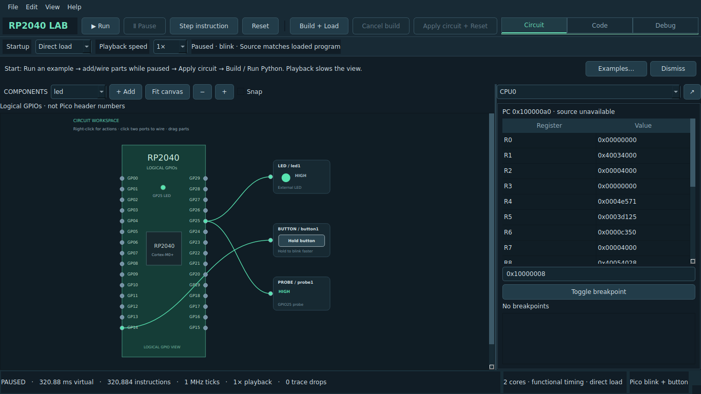

# RP2040 Lab

Run C firmware or MicroPython on a simulated RP2040, connect virtual peripherals,
and inspect the chip while your program runs. RP2040 Lab provides a desktop GUI
and a command-line interface, with a C simulation engine and a Python/PySide6 UI.



**Status:** experimental, with tested firmware examples. Linux x86-64 and WSLg
are the validated platforms. The simulator uses approximate, deterministic
timing; it is not cycle accurate and does not run every Pico application.
See the [compatibility matrix](docs/compatibility.md) before choosing a workload.

## What you can do

- Run, pause and step real ARM firmware; inspect registers, memory and breakpoints.
- Wire LEDs, buttons, sensors, an SSD1306 OLED and a SPI loopback device.
- Inspect GPIO traces, plot serial values and examine I²C/SPI exchanges.
- Edit one C or MicroPython source file, with optional local code assistance.
- Use the MicroPython UART REPL and manage files in simulated flash.
- Open editor, output and inspector panels in separate windows sharing one chip.
- Save circuit projects, export flash and replay recorded inputs from the CLI.

PIO, DMA and two-core examples are included. Core-0 B2 ROM boot is supported
following a separate ROM preparation step. USB/BOOTSEL transfers, an analog circuit
solver and general Arduino/CircuitPython compatibility are not implemented.

## Quick start on Linux

You need **Python 3.10+**, a C compiler, matching Python development headers and a
working Linux desktop display. Python 3.12 on Linux x86-64 is the tested setup.
No physical Pico, ARM compiler or Pico SDK is needed to run the bundled C demos.

On Ubuntu/Debian, install the build prerequisites:

```sh
sudo apt update
sudo apt install build-essential python3-dev python3-venv
```

Clone this repository or extract its source archive, then run these commands
from the repository's root directory:

```sh
python3 -m venv .venv
.venv/bin/python -m pip install --upgrade pip
.venv/bin/python -m pip install -e '.[gui]'
.venv/bin/rp2040-sim gui
```

Installation downloads Python dependencies and compiles the native engine.
For minimal Linux/WSL installations, see the
[installation and display guide](docs/getting-started.md) for Qt runtime packages
and troubleshooting. Native Windows and macOS builds are not validated.

## Try your first circuit

1. Launch the GUI and press **F5 / Run**. The bundled LED example starts blinking.
2. Hold the circuit's button to make the LED blink faster; release it to slow down.
3. Choose **Debug**, then **Logic analyzer** in the output area, to inspect GPIO25.
4. Press **F6 / Pause** before editing the circuit. Right-click to add components
   or click two ports to wire them; use **Apply circuit + Reset** to apply wiring.
5. Save the project with **Ctrl+S**. It includes the circuit and source buffer;
   exporting runtime flash and saving a host source file are separate actions.

The **Circuit**, **Code** and **Debug** tabs change the layout. **Ctrl+J** toggles
docked output. Use **↗** or **View → Panels** to open a tool in another window;
close that window to dock it back. **View → Reset layout** restores the defaults.

To edit and rebuild C, [install the ARM toolchain](docs/getting-started.md#build-your-own-c-code).
**F7** builds and loads the source; **F5** runs it. The Startup selector chooses
Direct load, ROM boot or the SDK shortcut. These modes require different source
entry points; the [boot guide](docs/boot.md) explains which to choose.

For MicroPython, first [prepare the B2 ROM](docs/boot.md#prepare-the-rom-once),
then open **File → Examples → New MicroPython project** and press **F7 / Run Python**.
The bundled UART firmware is a specific tested profile; stock USB firmware is
not supported. See the [MicroPython guide](docs/micropython.md).

## Run without a GUI

For a headless-only installation, use `.venv/bin/python -m pip install -e .`
instead of the GUI installation command above. Run blink or a named example:

```sh
.venv/bin/rp2040-sim run --duration-ms 1000
.venv/bin/rp2040-sim run --project examples/workbench.json --duration-ms 1000
```

UART output goes to stdout; the execution summary goes to stderr. Durations use
simulated time. See [examples and CLI workflows](docs/examples.md) for trace
export, replay, custom firmware and the OLED dashboards.

## Documentation

Start with the [documentation index](docs/README.md), or choose a guide:

| I want to… | Read |
| --- | --- |
| Install or fix a display/build error | [Getting started](docs/getting-started.md) |
| Learn the GUI, shortcuts and separate windows | [Desktop workflow](docs/desktop.md) |
| Edit code and set up clangd/Pyright | [Code editor](docs/editor.md) |
| Try firmware examples or automate a run | [Examples and CLI](docs/examples.md) |
| Use the OLED, plots, buses or Pico files | [Runtime tools](docs/runtime-tools.md) |
| Understand supported hardware and limits | [Compatibility](docs/compatibility.md) |
| Understand the implementation | [Engine and backend](docs/backend.md) |
| Contribute or run checks | [Contributing](CONTRIBUTING.md) |

Development plans and historical milestone evidence live under [plan/](plan/README.md).
Current behavior is described in the user guides and compatibility matrix.

## License

Original RP2040 Lab code and documentation are licensed under the
**GNU General Public License, version 2 or later** (`GPL-2.0-or-later`). See
[LICENSE](LICENSE) for the full terms. Third-party code and bundled firmware
retain their own licenses; see [third-party notices](THIRD_PARTY_NOTICES.md).
