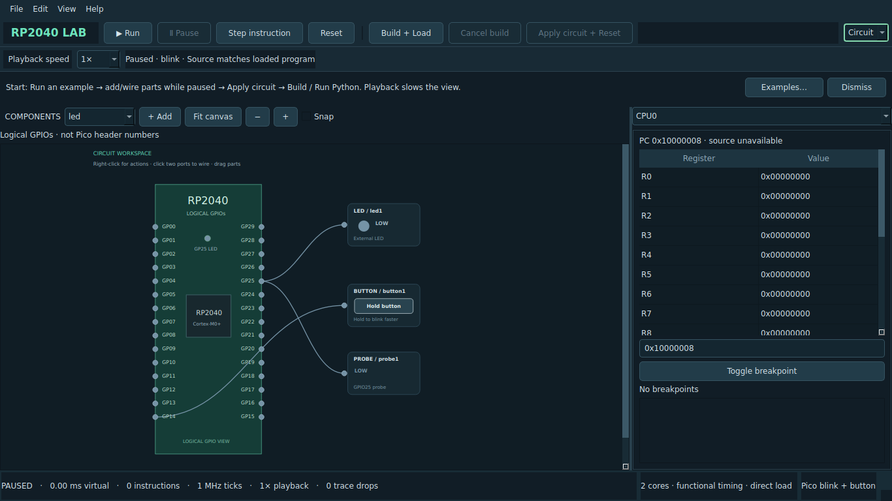

# Desktop workflow

Launch `.venv/bin/rp2040-sim gui`. Choose **File → New project / examples…**
or press Ctrl+N for C blink, MicroPython, buses, PIO, DMA or two cores.
The older direct example entries are grouped under **File → Examples**.
Bundled C examples need no compiler; MicroPython/ROM projects need the local B2 ROM.
**Help → ROM and compiler setup** explains the existing preparation commands.

## Layout and controls

Select the **Circuit / Code / Debug** tabs in the top toolbar to switch workspaces.

- **Circuit** gives the canvas the available height and hides the editor/output panel.
- **Code** gives the source editor the central area and hides the circuit/inspector.
- **Debug** shows canvas, inspector and editor/output together.
- **View** restores hidden panels, resets the layout, changes editor text size and
  exposes Advanced controls for the functional CPU clock and instruction limits.

The collapsible output panel sits below the editor; Ctrl+J toggles it. Opening
UART/compiler output preserves the source view. See the [code editor guide](editor.md)
for editing shortcuts, find/replace, code assistance and Problems.

Window geometry, workspace, panel sizes/visibility and text size are per-user
preferences. They do not change project JSON, chip timing or recorded input.
Reset layout restores a usable Circuit workspace. Playback speed changes the
relationship to wall time; applying a functional CPU clock resets execution.

## Edit, apply and recover

Add parts from the visible component control or the background right-click menu.
Click two ports to wire them. A dashed preview follows the pointer; Escape cancels
without changing connections. Optional Snap rounds movement to a 16-unit grid.
The board shows logical GPIO numbers, not physical Pico header numbers.

The **Properties** inspector provides standard keyboard-accessible controls for
selecting components/ports, setting labels and I²C addresses, connecting and
disconnecting, movement, duplication and deletion. A selected net lists endpoints
and textual GPIO states. The graphics remain a functional diagram, not an
electrical current/power simulation.

Circuit edits are validated and undoable while paused. Removing parts also removes
their attached wires; undo restores both. A completed drag is one history step.
Movement and label changes do not restart the chip. Wiring/device changes remain
pending until **Apply circuit + Reset** or **Apply + Run**, which restart CPU/RAM
and clear breakpoints. ROM-mode circuit application retains modified flash files.
Modified SDK flash requires export and an explicit discard/replacement workflow;
automatic SDK flash restoration is not supported.

Ctrl+Z/Ctrl+Shift+Z undo/redo circuit changes when focus is outside editable text
fields. Text undo/redo remains independent. Arrow keys
move selected canvas parts; Ctrl+D duplicates selected components and internal
connections. Delete removes the selection. Shift+F10/the keyboard menu key opens
a context menu for the focused or selected canvas object on supporting platforms.
Properties controls provide an alternative to canvas gestures.

## Source and loaded program

The execution bar identifies the loaded image and paused/running/build/upload
state. Editing C shows **Edited — rebuild required**. F7 builds a scratch copy and
loads it only after success; editing during a build leaves the newer source marked
different. A failed load keeps the previous working session. During document
replacement the editor becomes read-only until acknowledgement.

MicroPython uses **Run Python** and the raw UART REPL. The identity compares the
editor with the last uploaded source; it does not imply Python line debugging.
Uploads/programs can be interrupted through the serial panel. Output appears in
Serial · UART0, and the program returns to the interpreter when finished.

The editor has line numbers and language-appropriate highlighting. For C builds
with DWARF information, click the gutter or press F9 to toggle a mapped breakpoint.
The CPU inspector lists breakpoints; activate an entry to remove it. Address/function
breakpoints remain available without line information. The source execution marker
appears only when it matches the loaded source. Bundled ELF assets lack DWARF:
build their source to obtain line mapping. Unsupported mappings show the PC address
and retain side-effect-free memory inspection. F10 steps one instruction on the
next runnable core; it is not source-level Step Over.

Compiler errors navigate to the editor line when they refer to the same source
revision. Detailed output remains in Build + diagnostics; error banners offer
details, setup help and flash export.

## Save and close

Ctrl+S saves project JSON, including the source buffer and circuit. Ctrl+Shift+S
saves the source file separately. A modified marker compares content with the
saved project; undoing to saved content clears it. Close/project replacement offers
Save/Discard/Cancel. Canceled or failed saves leave the document available.

Runtime flash is a separate artifact. A changed MicroPython filesystem is not
stored in project JSON. Export it from File or the error-recovery controls. Closing
or replacing modified, unexported flash prompts for export/discard/cancel. Loading
the exported binary later restores its runtime files. Layout changes and clearing
output do not reset the chip or discard flash.

## Logic analyzer

In Debug, open Logic analyzer and enter comma-separated GPIO numbers, then Set.
Use zoom, pan, Fit and Follow latest independently of the simulation. Click for
cursor A; Shift+click sets B. Both cursors also have keyboard-editable fields,
accepting exact nanoseconds or values such as `250 ms` and `1 us`.

Measurements use virtual timestamps. Δt is the cursor separation. Frequency/duty
for the first selected channel require two rising edges and known digital states.
Buffer truncation or dropped events disables signal measurements until clearing
the trace starts a new capture interval. HIGH/LOW/FLOATING/CONFLICT also have
1/0/Z/! labels. This panel does not synthesize I²C/SPI pin waveforms from bus transactions.

## Validation limits

The desktop was checked through automated Qt workflows on Linux/WSLg, including
1366×768 and offscreen 100%/125%/150% scaling. Standard-widget accessibility
interfaces and keyboard alternatives were inspected. Participant usability sessions
and an Orca/screen-reader audit have not been performed. These remain open in
[Phase 2 status](../plan/phase-2/implementation-status.md).
