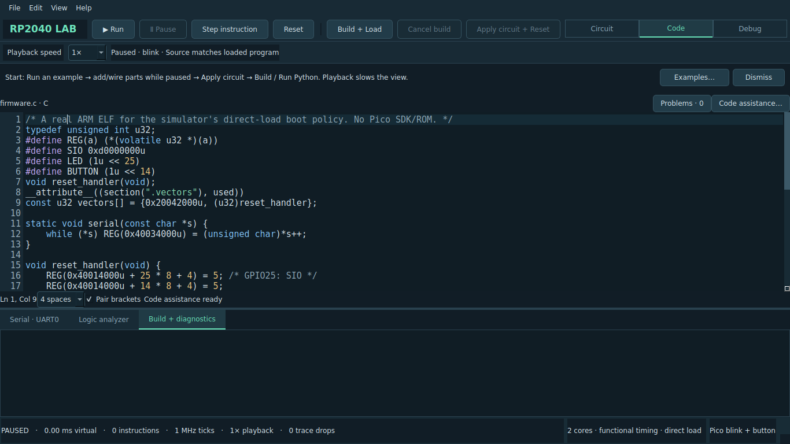

# C and MicroPython editor

Launch `.venv/bin/rp2040-sim gui` and select the **Code** workspace tab.
For a fresh checkout, first follow [Getting started](getting-started.md).
The source occupies the central area. **Debug** restores the circuit and inspector
alongside it; switching layouts preserves the source, cursor and undo history.

UART, compiler output and the logic analyzer are in a collapsible output panel
below the source. **View → Output panel**, or **Ctrl+J**, toggles that panel.
Build/upload opens the relevant output without replacing your editor.



## Editing

The editor supports C and MicroPython highlighting, including multiline comments
and strings, line numbers, current-line and matching-bracket highlights, automatic
indentation, soft tabs and optional bracket/quote pairing. Choose 2, 4 or 8 spaces
and toggle pairing in the footer. These preferences and font size are per-user.
Selection indentation, comment toggling, completion and replace-all each undo as
one operation. Normal clipboard, selection and input-method behavior uses Qt.

| Shortcut | Action |
| --- | --- |
| Tab / Shift+Tab | Indent / unindent; Tab accepts a visible completion |
| Ctrl+/ | Toggle line comments on the current line or selection |
| Ctrl+F / Ctrl+H | Find / find and replace |
| F3 / Shift+F3 | Next / previous match |
| Ctrl+G | Go to line, or line:column, starting at 1 |
| Ctrl+Space | Request code completion |
| F12 | Go to definition |
| Escape | Dismiss completion, documentation or search |
| F7 | Build and load C, or upload and run MicroPython |
| F9 | Toggle a supported mapped C breakpoint |
| Ctrl+Z / Ctrl+Shift+Z | Undo / redo focused editable text; circuit history when canvas/Properties controls have focus |
| Ctrl+S / Ctrl+Shift+S | Save project / save source as |

Find supports case sensitivity, whole words and Python regular expressions.
Regex replacement supports capture groups such as `\1`; invalid patterns or
replacements show an explanation without changing the buffer. Search wraps around.

The filename's `*` means the source differs from its source-file save. The window
and project name track unsaved project changes separately. Project JSON embeds
source; it does not overwrite the separate source file or export runtime flash.

## Optional local code assistance

Open **Code assistance…** above the editor, or **Help → Code assistance setup…**.
The dialog detects local tools and lets you select executable and stub paths.
Choose **Apply + Restart** after changing settings. Commands shown there are
instructions; the application does not download or install tools.

Completion appears after typing a word or `.`, or pressing Ctrl+Space. Use the
arrow keys and Enter/Tab to accept, or Escape to dismiss. Hover shows documentation;
typing `(` requests signature help. F12 navigates within the source or opens
external headers/stubs in a separate read-only preview. These features require
the corresponding language server. Basic editing works independently.

### C

Install `clangd` using your Linux package manager, for example:

```sh
sudo apt install clangd
```

The ARM compiler is also required for target-header discovery. Set `ARM_CC` if
needed; see [SDK setup](sdk-startup.md) for the supported Pico SDK 2.2.0 profile.
Direct firmware analysis shares the actual compiler flags. SDK/ROM C profiles
configure the SDK asynchronously to generate real include paths, definitions and
headers, then use its compilation database. This does not load or reset the chip.
The status line reports preparation failures; use setup to restart after fixing
the toolchain or SDK path.

### MicroPython

Install Node.js/npm, then run from the checkout:

```sh
npm install --prefix .tools/editor pyright@1.1.414
.venv/bin/python -m pip install --target .tools/editor/micropython-stubs \
    micropython-rp2-rpi_pico-stubs==1.26.0.post1 \
    micropython-stdlib-stubs==1.26.0.post3
```

Pyright, Pico stubs and MicroPython standard-library stubs are discovered there
automatically. For other installation locations, select their paths in setup.
The stub directory must contain `machine.pyi` and `stdlib/builtins.pyi`.
The editor uses basic checking in an isolated analysis workspace, separate from
the simulator's host Python packages. Assistance targets the firmware's 1.26 API.

The application checks configured paths, PATH and `.tools/editor`; it also finds
versioned `clangd` executables and extracted `clangd*/bin/clangd` directories.
These tools are optional and are not bundled in the simulator wheel. Once
installed they work locally without a cloud service.

## Diagnostics and program identity

**Problems** lists live **Analysis** results separately from **Compiler** results.
Select an entry to navigate to its location. Editor underlines coexist with
search, bracket and execution markers. Compiler output remains available in
**Build + diagnostics**; Python output/tracebacks remain in **Serial · UART0**.

Edits clear live annotations while analysis catches up. Delayed request results
are discarded when their document/revision is obsolete. Compiler results from
an older buffer remain labeled **old build** and do not underline or navigate
the newer source. Undoing to the built source makes those locations usable again.

The loaded firmware remains associated with exactly the text that built it.
Editing during a build does not replace the newer source with its snapshot.
Execution and source-breakpoint markers require a match with loaded C debug
information. F10 still steps one machine instruction; Python line debugging is
unavailable. API stubs describe MicroPython interfaces, not simulated hardware
coverage; see [MicroPython compatibility](micropython.md).

## Validation

Imported SDK projects use the same editor with a target/source selector and the
project's real compilation metadata. F7 builds saved disk files; **Save source**,
circuit saving and host-copy saving have distinct behavior. See
[Pico SDK projects](sdk-projects.md) for setup, generated headers and provenance.

The editor tests cover native editing, search/replacement, Unicode positions,
completion transactions, diagnostic revisions, layout/preferences and read-only
previews. A deterministic subprocess tests fragmented LSP messages, delayed
responses, cancellation, timeouts, crashes and shutdown. Run these with:

```sh
QT_QPA_PLATFORM=offscreen .venv/bin/python -m pytest tests/test_editor.py
```

The real-tool acceptance checks require clangd, ARM GCC, Pico SDK 2.2.0, Pyright
and the pinned stubs. Missing tools fail these checks rather than satisfying them
through fallback behavior:

```sh
QT_QPA_PLATFORM=offscreen RP2040_TEST_LANGUAGE_SERVERS=1 \
    .venv/bin/python -m pytest tests/test_editor.py
```

`RP2040_CODE_ASSIST=0` disables background assistance when running isolated
simulator/GUI tests or troubleshooting. Unset it to use the language servers.

The delivered revision passed **367 tests**, including all three real-language
contexts, on Linux/WSL2. Tools used were clangd 23.1.0, Pyright 1.1.414, ARM GCC
13.2, Pico SDK 2.2.0 and the pinned stubs above. The installed wheel passed GUI
startup and completion checks for direct C, SDK C and MicroPython. Desktop checks
passed on WSLg at 1366×768 and offscreen at 125%/150% scaling; the
[WSLg result](benchmarks/editor-wayland.json) includes the GUI source digest.
